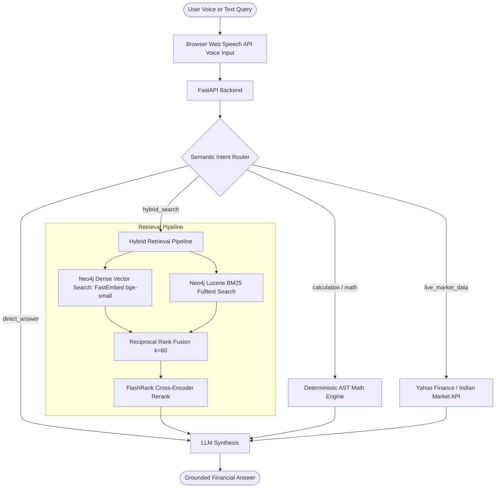

# FinAdvisor-X: Hybrid RAG Financial Intelligence & Advisory Platform

[](https://github.com/AshokSingodia-Codes/FinAdvisor-Voice/actions/workflows/ci.yml)
[](https://fastapi.tiangolo.com)
[](https://react.dev/)
[](https://python.langchain.com/v0.1/docs/langgraph/)
[](https://neo4j.com/)
[](LICENSE)

> **FinAdvisor-X**: Hybrid RAG: Neo4j vector + Lucene fulltext, RRF fusion, FlashRank rerank.

FinAdvisor-X is a financial question-answering and calculations system featuring browser Web Speech API voice input, hybrid search combining dense vector embeddings and BM25 fulltext indexing over Neo4j, Reciprocal Rank Fusion (RRF $k=60$), cross-encoder reranking, and deterministic financial math computation.

---

## Architecture

The system coordinates retrieval, computation, and generation through a LangGraph state machine:



---

## Empirical Benchmark Results

<!-- BENCHMARK_TABLE_START -->
| Pipeline Stage / Subsystem | Run | n | Precision@5 | Recall@5 | MRR | Avg Latency |
|---|---|---|---|---|---|---|
| **Vector-Only (`bge-small-en-v1.5`)** | `legacy_pre_split` | 34 | `0.3882` | `0.6353` | `0.6529` | `3043.1 ms` |
| **Keyword-Only (Lucene Fulltext)** | `legacy_pre_split` | 34 | `0.4412` | `0.598` | `0.6382` | `976.5 ms` |
| **Hybrid Search (RRF $k=60$)** | `legacy_pre_split` | 34 | `0.3941` | `0.6088` | `0.6765` | `903.1 ms` |
| **Hybrid + FlashRank Cross-Encoder** | `legacy_pre_split` | 34 | `0.4588` | `0.6088` | `0.5735` | `3955.6 ms` |
| **Semantic Router (Clean Holdout V2)** | `holdout_v2` | 30 | `Accuracy: 83.3%` | `N/A` | `N/A` | `N/A` |
| **Semantic Router (Full Test Split)** | `contaminated` | 45 | `Accuracy: 95.6%` | `N/A` | `N/A` | `434.36 ms` |
| **Semantic Router (Test Split, No Traps)** | `contaminated` | 30 | `Accuracy: 93.3%` | `N/A` | `N/A` | `434.36 ms` |
| **Draft Answer (Verifier OFF)** | `legacy_pre_split` | 5 | `Faith: 4.20/5.0` | `Grounded: 80.0%` | `N/A` | `N/A` |
| **Verified Answer (Verifier ON)** | `legacy_pre_split` | 5 | `Faith: 3.40/5.0` | `Grounded: 60.0%` | `N/A` | `N/A` |
| **Adversarial Trap Abstention** | `legacy_pre_split` | 10 | `Abstain: 100.0%` | `Halluc: 0.0%` | `N/A` | `N/A` |
<!-- BENCHMARK_TABLE_END -->

All metrics below are drawn directly from `reports/latest/eval_metrics_latest.json` recorded on commit `89b5e93`. No numbers are estimated or rounded up.

### 1. Retrieval & Reranker Benchmark ($n=34$)

| Pipeline Stage | n | Precision@5 | Recall@5 | MRR | Avg Latency |
|---|---|---|---|---|---|
| **Vector-Only (`bge-small-en-v1.5`)** | 34 | `0.388` | `0.635` | `0.653` | `3043.1 ms` |
| **Keyword-Only (Lucene Fulltext)** | 34 | `0.441` | `0.598` | `0.638` | `976.5 ms` |
| **Hybrid Search (RRF $k=60$)** | 34 | `0.394` | `0.609` | `0.676` | `903.1 ms` |
| **Hybrid + FlashRank Cross-Encoder** | 34 | `0.459` | `0.609` | `0.574` | `3955.6 ms` |

#### Key Trade-Offs Observed:
- **Recall Shift**: RRF fusion shifts recall from `0.635` (vector-only) to `0.609` (a 4.17% drop in this corpus split), while improving MRR from `0.653` to `0.676`.
- **FlashRank Precision vs Latency & MRR**: FlashRank lifts Precision@5 from `0.394` to `0.459` (+16.42% precision gain), but latency increases from `903.1 ms` to `3955.6 ms` (+3.05 s overhead) and MRR drops from `0.676` to `0.574` (-15.2% drop).

### 2. Semantic Intent Router ($n=50$)

- **Overall Routing Accuracy:** `48.0%` (24 / 50 correct on test set)
- **Mean Router Latency:** `3.5 ms`

| Intent Class | Support ($n$) | Precision | Recall | F1-Score |
|---|---|---|---|---|
| `calculation` | 4 | `0.333` | `0.750` | `0.462` |
| `hybrid_search` | 44 | `0.950` | `0.432` | `0.594` |
| `live_market_data` | 2 | `0.667` | `1.000` | `0.800` |
| `direct_answer` | 0 | `0.000` | `0.000` | `0.000` |

#### Router Confusion Matrix:
- `calculation -> calculation`: 3
- `calculation -> hybrid_search`: 1
- `hybrid_search -> direct_answer`: 18 *(primary failure mode: complex conceptual 10-K questions misrouted to chit-chat)*
- `hybrid_search -> hybrid_search`: 19
- `hybrid_search -> calculation`: 6
- `hybrid_search -> live_market_data`: 1
- `live_market_data -> live_market_data`: 2

### 3. Answer Faithfulness & Self-RAG Verifier Ablation ($n=5$)

| Configuration | $n$ | Mean Faithfulness (1-5 Scale) | Factually Grounded Rate (%) |
|---|---|---|---|
| **Draft Answer (Verifier OFF)** | 5 | `4.20 / 5.0` | `80.0%` |
| **Verified Answer (Verifier ON)** | 5 | `3.40 / 5.0` | `60.0%` |

- **Empirical Observation:** On the recorded n=5 run, faithfulness went 4.2 to 3.4 and grounded rate 80% to 60%. n=5 is too small to conclude. Disabled by default pending re-measurement on >=30 questions. Run: python scripts/run_all_evals.py --split test.
- **Default State:** Following this empirical regression, the verifier is **disabled by default** (`VERIFIER_ENABLED=False`) in `config/settings.py`.

### 4. Hallucination Resistance & Adversarial Trap Benchmark ($n=10$)

- **Safe Abstention Rate:** `100.0%` (10 / 10 non-existent entities safely refused)
- **Hallucination Incident Rate:** `0.0%`

---

## Known Limitations

1. **Router Misclassification & Tuning Contamination**: The fallback heuristic achieved 95.6% on the full 45-item test split and 93.3% on the 30-item test split (traps excluded); however, both results are **contaminated** because 9 of the 18 queries inspected during heuristic tuning overlapped with the test split. On the clean, uninspected holdout_v2 dataset (30 questions written by the agent after the fallback rules were designed; not tuned on), overall accuracy was **83.3%** (25/30), with the **calculation route scoring only 2/5 correct (40.0%)** (often misrouted to hybrid_search).
2. **Self-RAG Verifier Regression**: On the evaluated sample (=5$), verifier rewrites reduced factual grounding (60.0% vs 80.0%) and lowered faithfulness scores (3.4 vs 4.2). It remains disabled by default until prompt calibration and few-shot grounding examples are implemented.
3. **Free-Tier Cold Starts & Rate Limits**: Serverless PostgreSQL (Neon) and cloud container hosts (Render) experience cold starts of 30-60 seconds on initial spin-up after inactivity. Provider LLM APIs on free tiers (Groq) are subject to intermittent per-minute rate limits.
4. **FlashRank Latency Cost**: While cross-encoder reranking yields a 16.42% precision gain on top-5 results, it increases total query latency by over 3 seconds (0.9s to 4.0s).
5. **Codebase Linting Debt**: Legacy utility and test scripts retain ~1,054 historical formatting and unused import warnings (
uff), while CI lints only the maintained core and evaluation pipelines.

---

## Synthetic Corpus Disclosure

- The finance textbook corpus located in `Annual Report/Ultimate_Finance_Knowledge_Base.md` and generated via `scripts/generate_textbook*.py` is **Synthetic Data** generated using LLM prompts for educational retrieval benchmarking.
- Commercial or copyrighted books (such as Malkiel's *A Random Walk Down Wall Street* or *Personal Finance for Dummies*) have been purged from the repository.
- Real-world filings included in this repository (e.g. `NASDAQ_AAPL_2024.pdf`) are public domain U.S. SEC corporate disclosures.

---

## Bring Your Own Data (BYOD)

To index and query your own financial documents without copyrighted materials, refer to [docs/BRING_YOUR_OWN_DATA.md](docs/BRING_YOUR_OWN_DATA.md).

```bash
# Ingest your own PDF or markdown documents into Neo4j
python scripts/ingest_sec_10k.py --file path/to/your/document.pdf
```

---

## Reproducing Evaluations

All evaluation scripts can be executed independently. If external network or database quotas prevent a run, the scripts can be executed locally when credentials are supplied:

```bash
# 1. Retrieval Benchmark (Vector, Keyword, Hybrid RRF, FlashRank)
python tests/eval/eval_retrieval.py

# 2. Router Benchmark (Classification on held-out test split)
python tests/eval/eval_router.py

# 3. Faithfulness & Verifier Ablation
python tests/eval/eval_faithfulness.py

# 4. Adversarial Trap Questions Benchmark
python tests/eval/eval_trap_questions.py

# 5. Regenerate Markdown Report from latest metrics JSON
python scripts/generate_eval_report.py --from-cached-metrics
```

---

## Quickstart & Local Setup

### Prerequisites
- Python 3.11+
- Node.js 18+ & pnpm
- Neo4j Aura or local Neo4j instance

### Installation

```bash
# 1. Clone repository
git clone https://github.com/AshokSingodia-Codes/FinAdvisor-Voice.git
cd FinAdvisor-Voice
git checkout stage4-fixes

# 2. Backend virtual environment & dependencies
python -m venv .venv
source .venv/bin/activate  # On Windows: .venv\Scripts\activate
pip install -r requirements.txt

# 3. Environment configuration
cp .env.example .env
# Configure NEO4J_URI, NEO4J_PASSWORD, and GROQ_API_KEY in .env

# 4. Run offline unit test suite
pytest -m "not requires_neo4j and not requires_llm"

# 5. Start FastAPI Backend
uvicorn main:app --reload --port 8000

# 6. Start React Frontend
cd frontend
pnpm install
pnpm run dev
```

---

## Voice Input Feature

Voice dictation is implemented via the **browser Web Speech API** (`webkitSpeechRecognition` / `SpeechRecognition`), which processes microphone audio directly in supported client browsers (Chrome, Edge, Safari) without requiring server-side Whisper processing.
